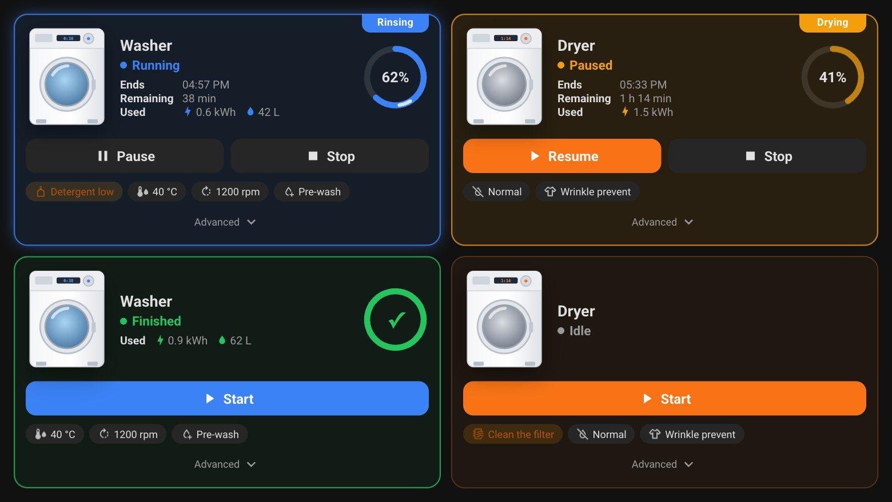
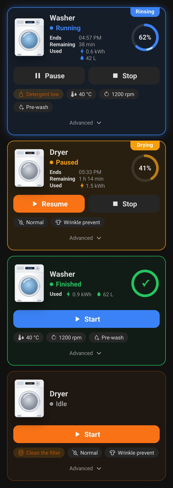
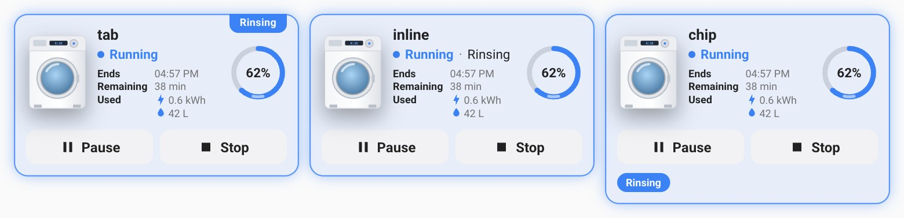
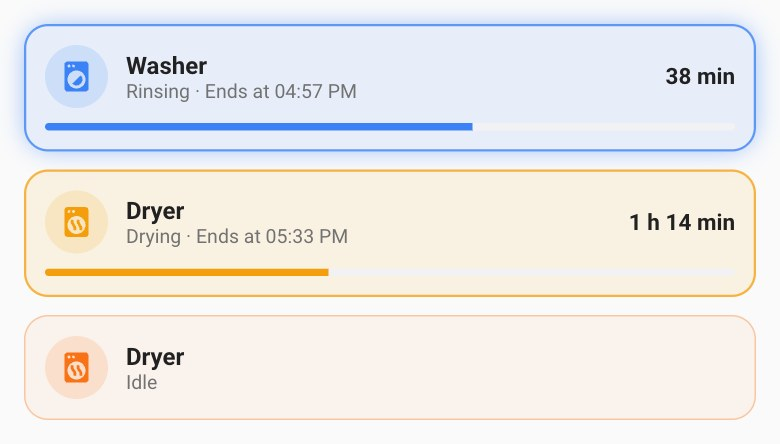
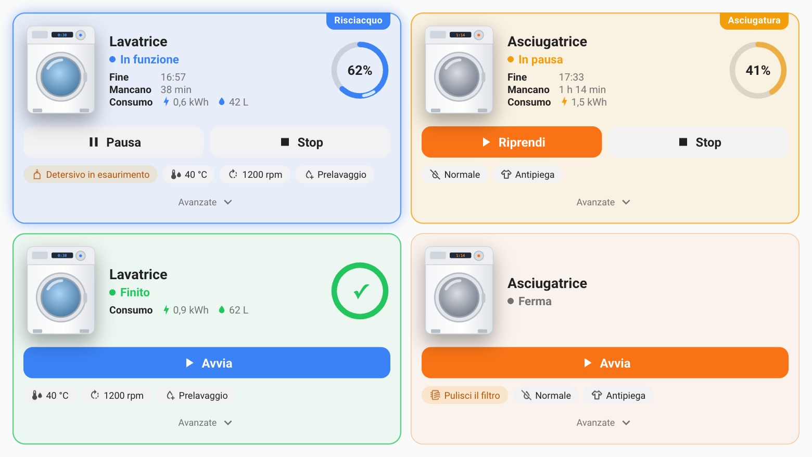

# Appliance Hero Card

[![hacs][hacs-badge]][hacs-url]
[![release][release-badge]][release-url]
[![validate][validate-badge]][validate-url]
[![license][license-badge]](LICENSE)

A Home Assistant card for a **washer, dryer or dishwasher**, built so you can read it at a glance. It shows:
- a picture of the machine;
- the phase it is in;
- a progress ring;
- when the cycle ends, and how much energy and water it has used;
- the buttons that make sense right now;
- the options that are set and what needs your attention.

The full programme — cycle, temperature, spin, delayed start — sits behind a chevron. Each of those controls is a
native Home Assistant tile.



> The machines in these screenshots are drawn, not photos. Run `npm run screenshots` to regenerate them.

## Why

A washer in Home Assistant is a dozen entities: state, phase, progress, time left, finish time, start, pause and
stop buttons, cycle and temperature selects, option switches, detergent warnings. Putting them on a dashboard
usually means a picture card, a stack of tiles and some `card-mod` with Jinja to colour them while the machine
runs. You repeat all that for every machine.

This card shows the same entities in one place and only when they matter. It needs a few lines of configuration,
or none at all if you use the visual editor.

## Features

- **The state at a glance:**
  - Running: the card lights up in the machine's colour.
  - Paused: it turns amber.
  - Finished: it turns green.
  - At rest it keeps a soft tint of its colour, so you still recognise it.
- **The phase in a tab** that hangs from the top edge: *Washing*, *Rinsing*, *Spinning*, *Drying*.
  - Built-in names for the common phases, in English and Italian.
  - The integration's own translation, or your own names (`phases`).
  - You can also put it after the state, in a chip, on the photo or under the ring.
- **A progress ring:**
  - While the machine runs, a light runs along the arc.
  - While it is paused, the arc breathes.
  - At the end a tick pops in.
  - The arc slides when the percentage changes.
  - The animations respect *reduce motion*, and `animate: false` turns them off.
- **Ends at** and **Remaining**, worked out from:
  - a duration in minutes, hours or seconds;
  - an `H:MM` string;
  - a timestamp;
  - or both together.
- **What the cycle has used:** energy, water, gas — from the total counters your machine or smart plug already has.
  - The card reads from Home Assistant's history what each counter said when the cycle started, and shows the
    difference: *Used ⚡ 0.6 kWh 💧 42 L*.
  - The row grows while the machine runs and stays under the tick when it has finished.
  - One history request per cycle, never polling. Without the recorder the row simply does not appear.
- **Buttons that fit the moment:**
  - Running: *Pause* and *Stop*.
  - Paused: *Resume* and *Stop*.
  - Idle or finished: *Start*.
  - Each button can be a `button`, `input_button`, `script`, `scene` or anything that turns on.
- **Options as chips:**
  - A select shows its value (*40 °C*, *1200 rpm*).
  - A switch appears only while it is on (*Pre-wash*).
  - **Alerts** appear in amber only while they are on (*Detergent low*).
- **Advanced section** behind a chevron. Each entity becomes a native tile with the control that fits it:
  - options for a select;
  - a slider for a number;
  - a toggle for a switch.

  You can also put any card of your own there — an energy graph, for example. Cards take the full width.
- **Works with most integrations:**
  - Samsung SmartThings, Home Connect, Miele and LG ThinQ states are recognised out of the box.
  - So is a plain binary sensor.
  - Your own state lists replace the defaults when an integration uses different words.
- **A compact layout** on one line with a progress bar, for an overview.
- **Visual editor** with sections and lists, in **English and Italian**.
- Light and dark themes, phone-friendly, sections-grid sizing.
- Redraws only when something it shows changes.
- No dependencies, no build step.

| Phone | Where the phase goes | Compact |
|---|---|---|
|  |  |  |



## Installation

### HACS (recommended)

[](https://my.home-assistant.io/redirect/hacs_repository/?owner=sleepyraptor&repository=homeassistant-appliance-hero-card&category=plugin)

That button opens the repository straight in your own Home Assistant. To add it by hand:

1. In HACS, open the three-dot menu and choose **Custom repositories**.
2. Add `https://github.com/sleepyraptor/homeassistant-appliance-hero-card` with category **Dashboard**.
3. Install **Appliance Hero Card**.
4. Reload your browser with a hard refresh (`Ctrl/Cmd + Shift + R`). In the companion app:
   **Settings → Companion app → Debugging → Reset frontend cache**.

### Manual

1. Download `appliance-hero-card.js` from the [latest release][release-url].
2. Copy it into `config/www/`.
3. Add the resource under **Settings → Dashboards → ⋮ → Resources**:
   `/local/appliance-hero-card.js`, type **JavaScript module**.
4. Hard refresh the browser.

## Quick start

Add the card from the picker (**Appliance Hero Card**) and set it up in the visual editor. Only the machine's
state entity is required. Or in YAML:

```yaml
type: custom:appliance-hero-card
entity: sensor.washer_machine_state
name: Washer
image: /local/appliances/washer.png
phase_entity: sensor.washer_job_state
progress_entity: sensor.washer_progress
remaining_entity: sensor.washer_completion_time
controls:
  start: button.washer_start
  pause: button.washer_pause
  stop: button.washer_stop
```

For the image, a PNG of the machine with a transparent background in `config/www/` looks best. Without an image
the card shows the icon instead.

## Configuration

Every option except `phases` is in the visual editor.

### Machine

| Option | Default | Description |
|---|---|---|
| `entity` | — | **Required.** The entity that says whether the machine is running, paused or finished. |
| `name` | the entity's name | |
| `icon` | `mdi:washing-machine` | Shown when there is no image, and in the compact layout. |
| `image` | — | `/local/…` or `https://…`. |
| `color` | `blue` | `blue`, `orange`, `green`, `purple`, `cyan`, `red`, `pink`, `teal`, `amber`, `indigo`, `"r,g,b"` or `#hex`. |
| `layout` | `full` | `full`, or `compact` for one line with a progress bar. |
| `phase_style` | `tab` | Where the phase goes: `tab` (top edge), `inline` (after the state), `chip`, `photo`, `ring` (under the ring). |
| `animate` | `true` | `false` keeps the ring still. |

### Cycle

| Option | Description |
|---|---|
| `phase_entity` | What the machine is doing: washing, rinsing, spinning… |
| `progress_entity` | Progress in percent, for the ring. |
| `remaining_entity` | Time left. Accepts minutes, hours or seconds (from the unit), `H:MM` / `H:MM:SS`, or a timestamp. |
| `finish_entity` | A timestamp for when it ends. If you give both, the time left comes from `remaining_entity` and the end time from `finish_entity`. |
| `phases` | Your own names for the phase states, e.g. `{ main_wash: Washing, rinse_hold: Waiting }`. YAML only. |

The phase name is chosen in this order:
1. your own name from `phases`;
2. the card's built-in name, in English or Italian;
3. the integration's translation;
4. the raw state, tidied up.

### Consumption (`consumption`)

A list of **total counters**; an item is an entity id, or `{ entity, name, icon, decimals }`.

| Key | Description |
|---|---|
| `entity` | **Required.** A sensor that only goes up: energy (`kWh`), water (`L`), gas… |
| `name` | Shown before the value. Usually not needed: the icon says what it is. |
| `icon` | Default: a bolt for energy, a drop for water, a flame for gas, from the sensor's device class. |
| `decimals` | Default: as many as the counter has (at most 2), none from 10 up. |

How it works:
- **The start of the cycle** is the moment the machine last went from rest to running or paused. The card asks
  Home Assistant's history (`history/history_during_period`, the last 24 hours) once per cycle — when the cycle
  starts, or when the dashboard opens during one — for the machine's state and the counters.
- **What it shows** is each counter's current value minus its value at that moment. The row stays while the
  machine runs, pauses and finishes, and goes away when it is at rest.
- **If a counter goes down** during the cycle (a reset), the new value is shown.
- **Accuracy** depends on the counter: many machines update their energy in steps of 0.1 kWh, so early in a cycle
  the value is approximate.
- **Without the history**, or for a counter that is not recorded, the row simply does not appear.

### Buttons (`controls`)

| Key | Shown when | Description |
|---|---|---|
| `start` | idle, finished, paused (as *Resume*) | Starts the cycle. |
| `pause` | running | |
| `stop` | running or paused | |
| `resume` | paused | Only needed if resuming is a different entity from `start`. |

A `button` or `input_button` is pressed, a `script` or `scene` is run, and anything else is turned on.

### Options, alerts and advanced

Each of these is a list. An item is an entity id, or `{ entity, name, icon }`.

| Option | Description |
|---|---|
| `options` | Chips under the buttons. A select or sensor shows its value; a `switch`, `input_boolean` or `binary_sensor` appears only while it is on. |
| `alerts` | Amber chips, shown only while the entity is on (`on`, `problem`, `detected`…). |
| `advanced` | Behind the chevron, as native tiles. A `select` gets its options, a `number` a slider, a `switch` a toggle, a `button` a press. An item with a `type` is used as a card config as is, across the full width. |
| `advanced_open` | `true` opens the advanced section by default. |

Tapping a chip opens its entity's details.

### States

The defaults below cover most integrations. A list you set **replaces** the default list for that state. Matching
ignores case.

| Option | Default |
|---|---|
| `running_states` | `on`, `run`, `running`, `active`, `in_use`, `washing`, `drying`, `rinsing`, `spinning`, `programmed_running`, `busy` |
| `paused_states` | `pause`, `paused`, `interrupted`, `suspended` |
| `finished_states` | `finished`, `finish`, `end`, `ended`, `complete`, `completed`, `done`, `program_ended`, `end_programmed` |

Two more cases are handled without any list:
- The machine also counts as **finished** when `phase_entity` is in `finished_states`. Some machines go back to idle
  while the phase still says *finish*.
- `off` and `unavailable` mean the machine is **off**: no buttons are shown.

### Actions

| Option | Default | Description |
|---|---|---|
| `tap_action` | `more-info` | Tap on the card, outside the buttons, chips and advanced section. |
| `hold_action` | `none` | Hold on the card. |

Every action Home Assistant supports works: `more-info`, `toggle`, `navigate`, `url`, `perform-action`,
`assist`, `none`.

## Examples

### Samsung SmartThings washer, with everything

```yaml
type: custom:appliance-hero-card
entity: sensor.washer_machine_state
name: Washer
image: /local/appliances/washer.png
color: blue
phase_entity: sensor.washer_progress
progress_entity: sensor.washer_progress_percent
remaining_entity: sensor.washer_completion_time
finish_entity: sensor.washer_estimated_finish
consumption:
  - sensor.washer_energy
  - sensor.washer_water_consumption
controls:
  start: button.washer_start
  pause: button.washer_pause
  stop: button.washer_stop
options:
  - entity: select.washer_wash_temperature
    icon: mdi:thermometer-water
  - entity: select.washer_spin_speed
    icon: mdi:rotate-right
  - entity: switch.washer_pre_wash
    name: Pre-wash
alerts:
  - entity: binary_sensor.washer_detergent_low
    name: Detergent low
    icon: mdi:bottle-tonic-outline
advanced:
  - entity: select.washer_cycle
    name: Cycle
  - select.washer_wash_temperature
  - select.washer_spin_speed
  - entity: number.washer_delay_start
    name: Delayed start
  - switch.washer_pre_wash
  - switch.washer_extra_rinse
  - type: tile
    entity: sensor.washer_energy
    features:
      - type: trend-graph
```

### A dryer on a smart plug, with a template binary sensor for "running"

```yaml
type: custom:appliance-hero-card
entity: binary_sensor.dryer_running
name: Dryer
icon: mdi:tumble-dryer
color: orange
consumption:
  - sensor.dryer_plug_energy
```

### Home Connect dishwasher, compact, with your own phase names

```yaml
type: custom:appliance-hero-card
entity: sensor.dishwasher_operation_state
name: Dishwasher
icon: mdi:dishwasher
color: teal
layout: compact
progress_entity: sensor.dishwasher_program_progress
finish_entity: sensor.dishwasher_program_finish_time
phases:
  drying: Drying the dishes
```

## Coming from a picture card, tiles and card-mod

| You had | Use |
|---|---|
| A `picture` card with card-mod for the drop shadow | `image` |
| A tile for the state, coloured by card-mod Jinja while running or paused | built in, with `color` |
| Tiles for progress, finish time and time left | `progress_entity`, `finish_entity`, `remaining_entity` |
| A grid of start / pause / stop tiles | `controls` — only the buttons that make sense are shown |
| Tiles for the cycle, temperature, spin and delayed start | `advanced` |
| Tiles for option switches and detergent warnings | `options` and `alerts` |
| An energy tile with a trend graph | `consumption` for this cycle, and the tile itself in `advanced` |

## Development

```bash
npm install
npm test               # node --test with happy-dom
npm run demo           # the card on drawn machines: http://127.0.0.1:8767/demo/
npm run screenshots    # regenerates docs/*.jpg with a local Chrome (set CHROME=… if needed)
```

The card is a single file, `dist/appliance-hero-card.js`, with no build step.

## License

[MIT](LICENSE)

[hacs-badge]: https://img.shields.io/badge/HACS-Custom-41BDF5.svg
[hacs-url]: https://hacs.xyz
[release-badge]: https://img.shields.io/github/v/release/sleepyraptor/homeassistant-appliance-hero-card
[release-url]: https://github.com/sleepyraptor/homeassistant-appliance-hero-card/releases/latest
[validate-badge]: https://github.com/sleepyraptor/homeassistant-appliance-hero-card/actions/workflows/validate.yml/badge.svg
[validate-url]: https://github.com/sleepyraptor/homeassistant-appliance-hero-card/actions/workflows/validate.yml
[license-badge]: https://img.shields.io/github/license/sleepyraptor/homeassistant-appliance-hero-card
